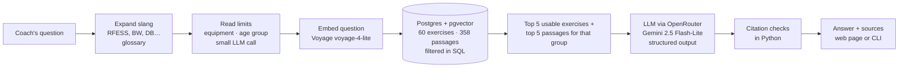
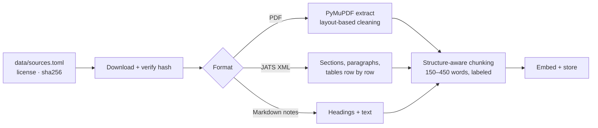
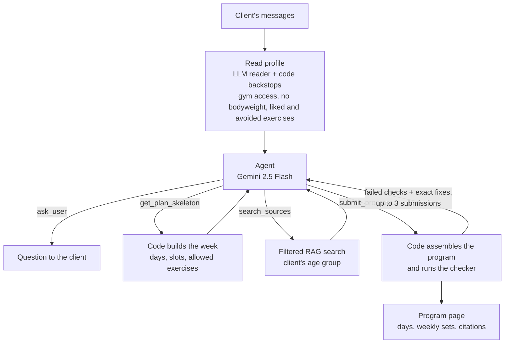

# rag-motion

A retrieval-augmented assistant for strength coaches. Ask a training question in plain English and get an answer built **only** from vetted sources: public exercise guidelines, open-access research, coaching notes, and an exercise catalog. Every claim links to its source, and code checks every citation. A second mode builds a full training program: a tool-calling agent interviews the client, builds the week from the same catalog and sources, and code checks every program before it is shown.

Built step by step as an AI-engineering portfolio project, with every decision and lesson documented in [`docs/`](docs/).

**Status:** Phase 1 (production RAG fundamentals), Phase 1F (better retrieval, measured) and Phase 2 (program agent) complete. Answers that broke a client's equipment or age-group limits went from 31% to 0%. Programs that broke a structural rule went from 5 in 20 to 0 in 90 once code, not the model, laid out the week. Still open: a reviewer's verdict on each program in the latest review sheet.

---

## What it does

- **Answers from evidence, not memory.** The model sees only retrieved passages and exercises, cites each one by id, and says plainly when the sources don't cover a question.
- **Shows its work.** The web page color-codes citations (guidelines, research, notes, catalog) and opens the exact source passage on click. General training knowledge, when useful, is shown separately and labeled "not from your sources".
- **Respects limits.** It reads the person's equipment and age group from the question and filters the search, so someone with only dumbbells never gets a bench exercise, and a beginner adult never gets older-adult numbers.
- **Checks itself.** Python verifies that every citation points to retrieved evidence, catching invented or mistyped sources before the user trusts them.
- **Understands coach slang.** "RFESS", "BW squat", "SL RDL" and "KBS" are expanded before search by a small, tested glossary.
- **Builds programs.** A program agent asks for what's missing (goal, days per week, equipment, level), then fills a week that code lays out, with sets, reps, rest, progression and cited reasons. Code checks every program and sends failures back with exact fixes.
- **Is measured.** A 55-question evaluation set, with an answer key I reviewed against my exercise science training, scores both retrieval and answers. 14 fictional clients score the program agent. Every change is judged against them.

## How it works

**Answering a question:**



**Ingestion** (one-time per source):



The program agent has its own loop, described in [Program agent](#program-agent-phase-2) below.

Key design choices (full reasoning in [`docs/decisions/`](docs/decisions/README.md)):

| Choice | Why |
|---|---|
| Postgres + pgvector, not a separate vector database | Exercises, passages, and vectors live together; filters and similarity run in one query |
| Structure-aware chunks with a location label (`title > chapter > section`) | One topic per chunk; the label gives context instead of overlap and makes citations readable |
| Research papers as structured XML, not PDF | No two-column layout guessing; tables survive row by row |
| Structured output + code-based citation checks | A valid shape doesn't guarantee valid content; code catches what the model gets wrong |
| Evidence-only answers with separately labeled general guidance | The coach can always tell what's verified from what isn't |
| Limits enforced by filters in the database search, not prompt rules | With prompt rules alone, 5 of 13 constrained answers still broke a limit; the model can't suggest what it never sees |
| Age-group tags on passages from the source's own structure | The guidelines are organized by population, so rules tag every passage for free, testably, with no model guessing |
| Slang expanded by a glossary, not an LLM rewrite | Same quality as an LLM rewrite in testing, no added time, deterministic and unit-tested |
| Code checks for facts; an AI judge only for the labeling rules | Facts (real citation? forbidden item?) stay deterministic. Rules that need reading ("is it labeled intermediate?") go to a stronger model from a different family, never the one that wrote the answer |
| Code builds the program's week; the agent fills the slots | Structural rules are math. When the model laid out the week, about 1 in 4 programs broke one; with code-built layouts, none did |

## Knowledge base

| Source | Type | License | Passages |
|---|---|---|---|
| Physical Activity Guidelines for Americans, 2nd ed. (HHS, 2018) | Guideline document (PDF) | Public domain | 133 |
| Kons et al. 2023, *Effects of Plyometric Training on Physical Performance: An Umbrella Review* | Research article (XML) | CC BY 4.0 | 25 |
| Haugen et al. 2019, *The Training and Development of Elite Sprint Performance* | Research article (XML) | CC BY 4.0 | 28 |
| Schoenfeld et al. 2021, *Loading Recommendations for Muscle Strength, Hypertrophy, and Local Endurance* | Research article (XML) | CC BY 4.0 | 28 |
| Singer et al. 2024, *Give it a rest: inter-set rest intervals and muscle hypertrophy* | Research article (XML) | CC BY 4.0 | 18 |
| Pelland et al. 2024, *The Resistance Training Dose-Response* (weekly volume and frequency) | Research **preprint, not peer reviewed** (PDF; the peer-reviewed version is paywalled) | CC BY 4.0 | 29 |
| Iversen et al. 2021, *No Time to Lift? Designing Time-Efficient Training Programs for Strength and Hypertrophy* | Research article (XML) | CC BY 4.0 | 30 |
| Refalo et al. 2023, *Influence of Resistance Training Proximity-to-Failure on Skeletal Muscle Hypertrophy* | Research article (XML) | CC BY 4.0 | 27 |
| Bastos et al. 2024, *Feasibility and Usefulness of Repetitions-In-Reserve Scales for Selecting Exercise Intensity* | Research article (XML) | CC BY 4.0 | 23 |
| Notes on NSCA position statements: weightlifting, older adults, youth/LTAD | Original project notes | Project-owned; cite NSCA | 14 |
| Program-design notes (load, reps, rest, sets, frequency, splits, progression) | Original project notes, reviewed by me | Project-owned | 3 |
| Exercise catalog | 60 original exercises, all reviewed by me | Project-owned | – |

Sources are chosen under a written [licensing policy](docs/decisions/0017-knowledge-source-licensing-policy.md): copyrighted material (for example NSCA publications) is never ingested; it enters only as original notes that cite it. Every passage is tagged with the group it's about (adults, older adults, youth, pregnancy, or general), so the program-design research on healthy adults never answers a question about a 70-year-old. Downloaded files stay out of git; [`data/sources.toml`](data/sources.toml) records each source's URL, license, attribution, and file hash.

## Evaluation

55 questions in [`evals/eval_set.yaml`](evals/eval_set.yaml): exercise selection, coach slang (RDL, RFESS, BW, DB, KBS), equipment limits (bands only, one kettlebell, no equipment, a full gym), guideline dosage, specific groups (beginner adults, older adults, kids, pregnancy), program design (weekly sets, rest, rep ranges, frequency, session length, proximity to failure, reps in reserve), research questions, and deliberately unanswerable ones. The answer key was drafted by the model and **set question by question by the coach** for the first 52 questions; the 3 program-design questions added in Phase 2 were approved as a batch. Two questions are traps: with a full gym nothing should be filtered out, and a 70-year-old's "how many sets" must not be answered from research on younger adults.

**Answers** (full pipeline, 3 runs, scored in code; results in `evals/results/`). Measured on the 52-question version; 3 program-design questions were added since, and the answer eval has been run on all 55 only once, without the AI judge, so these 3-run figures stay the reference:

| Check | Result |
|---|---|
| **No forbidden advice** (wrong equipment or age group) | **100%** (45 / 45) |
| Every citation points to retrieved evidence | 97% |
| Used the expected evidence | 95% |
| Honest coverage claim (full / partial / none) | 91% |
| Expected exercises named (list questions) | 85% |

4 of 156 question-runs failed with a clear error and are left out of the totals: 3 timeouts during a provider slowdown (each call has a 25-second limit) and 1 unreadable model reply after a retry.

**What changed the numbers.** Each change was measured on the same questions before it was kept.

| Change | Measured effect | Kept? |
|---|---|---|
| Equipment and age-group **filters in the SQL search** (prompt instructions had failed) | Forbidden advice 31% → 0% of limit questions (3 runs each, 40-question version); recall 0.80 → 0.83 | ✅ |
| **Slang glossary** before search | Slang questions found the expected exercise 89% → 100%; forbidden-free 93% → 100% | ✅ |
| LLM rewrite of slang instead of the glossary | Same quality, +0.6 s per question | ❌ |
| **Hybrid search** (keyword + semantic, weighted 1:1 to 3:1), or hybrid only for passages | With filters on, semantic ranked passages best (MRR 0.84 vs 0.81–0.83); split answers had a worse coverage claim | ❌ |
| 10 exercises per question instead of 5 | Lists 12% more complete, but more unasked-for exercises in focused answers | ❌ |
| Formatting rules for coaches added to the answer prompt | No version beat the plain prompt; padded focused answers | ❌ |

**Retrieval** (top 5, measured on the 52-question version):

| Search setup | Exercise recall | Passage recall | Passage MRR | Questions with a forbidden item |
|---|---|---|---|---|
| Keyword (Postgres full-text) | 0.64 | 0.55 | 0.45 | 13% |
| Hybrid (reciprocal rank fusion) | 0.75 | 0.90 | 0.83 | 17% |
| Semantic | 0.81 | 0.95 | 0.81 | 15% |
| **Semantic + filters + slang glossary (default)** | **0.87** | **0.95** | **0.84** | **0%** |

On the current 55 questions, after the Phase 2 catalog and source additions, the default setup scores exercise recall 0.84 (lower because the expected lists grew with the catalog), passage MRR 0.86, passage hit rate 1.00, and still no forbidden items.

The labeling rules (label intermediate exercises for beginners, label bodyweight options and secondary muscles, group beginner exercises by muscle group) are graded by an AI judge: Claude Sonnet 5.5, a different model family from the one that writes answers, checked against the catalog's facts. The rule that still fails is grouping a full beginner list by muscle group, which needs more than 5 exercises in view.

Lessons from the process: when the catalog grew from 20 to 42 exercises, recall "fell" only because the answer key was out of date, so keys are fixed before anything is measured. The same thing happened at 60 exercises (exercise recall 0.87 → 0.84). Single runs are noisy, so comparisons use 3-run averages. And an earlier change can remove the problem a later technique was meant to solve: the age-group filter is why hybrid search no longer helps.

## Program agent (Phase 2)

A client describes what they want, on the program page or in the terminal. A tool-calling agent asks for anything missing, then builds a full week: days, exercises, sets, reps, rest, progression, and a cited rationale.



**What it does.**
- **Refuses to build too early.** Until goal, days per week, equipment and level are all known, the building tools return "Not enough information yet" and name what to ask. A vague goal ("a workout program") counts as missing. Code reads the profile from the conversation; the agent never edits it.
- **Uses tools, not memory.** `get_plan_skeleton` returns the week's days and slots, each with the catalog exercises this client can use. `search_sources` is the same filtered search as the Q&A mode, limited to the client's age group.
- **Reads preferences in code.** A gym access phrase means all equipment ("home gym" doesn't). "I don't want bodyweight exercises" removes bodyweight-only options. Exercises the client names are passed on as liked, or removed from the options if disliked, including shorthand like "RDLs".
- **Handles health mentions.** Pregnancy gets a fixed message and no program. Any other health issue (read by the profile model, backed by a broad word pattern) requires a reminder to see a health professional.
- **Shows its work.** The [program page](#run-it-locally) shows each day, weekly sets per muscle group counted by code, citation chips that open the source passage, the tool calls, and the cost.

**Design: code for constraints, the model for judgment.** At first the agent designed the whole week while juggling about 18 rules, and about 1 in 4 programs still broke a structural rule after 3 tries. Now code builds the week's skeleton from fixed layouts for 1 to 6 days, taken from the program-design notes. Each layout puts every main movement pattern on 2+ days (in weeks of 2+ days) with no pattern doubled on a day, so the structural rules hold by construction. The agent picks one exercise per slot from the allowed options, sets the dosage, and explains it. Code assembles the program, so a pick outside a slot's options is sent back with the allowed list. See decisions [0051](docs/decisions/0051-program-checker-in-code-exact-fixes-three-submissions.md), [0052](docs/decisions/0052-agent-building-tools-refuse-until-profile-complete.md), [0073](docs/decisions/0073-code-builds-the-program-skeleton-agent-fills-slots.md) and the [structure fix](docs/build-log.md#phase-2-structure-fix-code-builds-the-program-skeleton-the-agent-fills-the-slots) in the build log.

**The checker.** `check_program()` in [`src/ragmotion/program.py`](src/ragmotion/program.py) runs 19 checks on every program, plus 2 that apply only to some clients: a fat-loss program must say nutrition isn't covered, and a client with a health issue must get a health-professional reminder. The 19 cover days per week, catalog-only exercises, equipment, level, movements excluded for the client (e.g. jumps for older adults), each main pattern on 2+ days, core or carry, exercises per day, one exercise per pattern and push/pull direction per day, day names that match their exercises, weekly sets per muscle group (counted in code; older adults get a lower minimum taken from the sources), sets/reps/rest present, timed planks and carries, citations only from the agent's own searches, and no weekly-set totals stated in the text. (The build log mentions 16 and then 18 checks at earlier steps; the volume-claim and fat-loss checks came later.) Each failed check carries an exact fix instruction. The agent gets up to 3 submissions; a program that still fails is shown with its failed checks, never hidden.

**Model choice.** A 6-model test (same conversation, 3 runs each) picked Qwen3.5 Flash: as reliable as Gemini 2.5 Flash at about a quarter of the cost. In live use on the page it stalled on program-sized answers (one call ran 847 s). The agent is back on **Gemini 2.5 Flash**, with Flash-Lite as a fallback and a hard 40-second deadline per model call ([0053](docs/decisions/0053-agent-model-qwen3-5-flash-after-six-model-test.md), [0069](docs/decisions/0069-agent-back-on-gemini-2-5-flash-with-flash-lite-fallback.md)). A short test is not the same as steady use.

**Results.** Fictional clients in [`evals/program_clients.yaml`](evals/program_clients.yaml), each a conversation plus expectations scored in code: the kind of reply (program, question, or message), whether the program passes every check, and client-specific rules such as "has a referral" (sore knee), "no adult-only research" (15- and 70-year-olds), "includes the lifts the client said they love", or "no deadlifts" ("I hate deadlifts"). Full log in the [P4 entry](docs/build-log.md#phase-2-step-4-p4-program-builder-eval-on-12-fictional-clients-and-three-checker-fixes-it-found) and the follow-ups after it.

| Run | Clients × runs | Expectations met | Programs passing every check | Median time | Total cost |
|---|---|---|---|---|---|
| P4, first run | 12 × 1 | 9 / 12 | 9 / 10 | 9.1 s | $0.083 |
| P4, after three checker fixes | 12 × 2 | 19 / 24 | 15 / 20 | 11.5 s | $0.20 |
| Code builds the skeleton (last of three evals) | 12 × 3 | 36 / 36 | 30 / 30 | 8.4 s | $0.159 |
| Latest, after gym, dislike and older-adult fixes | 14 × 3 | **42 / 42** | **36 / 36** | 8.8 s | $0.194 |

- With the skeleton, structural failures went from 5 of 20 programs to 0 of 90 across three 3-run evals (the before and after use 2 and 3 runs per client).
- In the latest eval, 34 of 36 programs were accepted on the first submission. A program costs about half a cent.
- The 2 clients added after P4 guard against over-reading: a home trainer who is "new to the gym scene" must get no gym equipment, and "I hate deadlifts" must remove every deadlift.
- One bug passed every check and every expectation: a client who said "I love back squats and hip thrusts … full gym" got neither, in 9 of 9 runs. The profile reader had dropped "full gym". Reading the saved programs, not the scores, found it. Code backstops and new expectation types closed it.

## Run it locally

**Prerequisites:** [Docker](https://www.docker.com/), [uv](https://docs.astral.sh/uv/), an [OpenRouter](https://openrouter.ai) API key (covers the LLM and embeddings). Optional: a [LangSmith](https://smith.langchain.com) key for tracing (off by default; set `LANGSMITH_TRACING=true` to debug a request).

```bash
git clone https://github.com/muskii1z/rag-motion.git && cd rag-motion
cp .env.example .env          # then add OPENROUTER_API_KEY (and optionally LANGSMITH_API_KEY)
uv sync                       # install dependencies

docker compose up -d --wait   # start Postgres + pgvector on localhost:5434
docker compose exec -T db psql -U postgres -d ragmotion -v ON_ERROR_STOP=1 < db/schema.sql

uv run python scripts/seed_exercises.py        # load the exercise catalog
uv run python scripts/embed_exercises.py       # embed it
uv run python scripts/download_sources.py      # fetch source documents, verify hashes
uv run python scripts/extract_document.py pag2                # extract the PDFs
uv run python scripts/extract_document.py pelland2024-volume
uv run python scripts/chunk_documents.py       # chunk all sources
uv run python scripts/embed_chunks.py          # embed the chunks
```

Then ask questions or build a program:

```bash
uv run uvicorn ragmotion.app:app --host 127.0.0.1 --port 8010   # Q&A at http://127.0.0.1:8010, programs at http://127.0.0.1:8010/program
uv run python scripts/ask.py "How much strength training should a beginner adult do each week?"
uv run python scripts/program_chat.py          # the program agent in the terminal, with every tool call shown
```

Tests and evaluation:

```bash
uv run pytest                                  # 173 tests, ~1.5 s, no API calls (6 database tests skip if Postgres isn't running)
uv run python evals/run_retrieval_eval.py      # retrieval scores (free)
uv run python evals/run_answer_eval.py         # answer scores + AI judge (~10 cents), saved to evals/results/ (LangSmith not needed)
uv run python evals/run_answer_eval.py --langsmith   # also record it as a LangSmith experiment
uv run python evals/run_answer_eval.py --no-filters   # the same, without the filters, for comparison
uv run python evals/run_program_eval.py --runs 3     # program agent on 14 fictional clients (~20 cents), results + review sheet in evals/results/
```

## Project layout

```
src/ragmotion/   config, db, models, llm, embeddings, retrieval, rewrite, rag, ingestion, chunking, evaluation, judge, errors,
                 program (skeleton, tools, checker), agent (program agent loop), web app (Q&A and program pages)
scripts/         seed, embed, download, extract, chunk, tag populations, search, ask, extract profile, program chat
evals/           eval set (reviewed answer key), program clients, three runners, saved results and program review sheets
db/              schema and inspection queries
data/            source manifest, exercise catalog, project notes (downloads in git-ignored data/raw/)
docs/            build log, decisions, concepts, interview prep, source research
tests/           unit and integration tests, including the program checker, skeleton, tools and a scripted fake model for the agent loop
```

## Documentation

- [Build log](docs/build-log.md): every step, including what broke and how it was fixed
- [Decisions](docs/decisions/README.md): each choice, the alternatives, and the tradeoffs
- [Concepts](docs/concepts.md): everything learned along the way, in plain language
- [Source research](docs/sources/candidates.md): candidate knowledge sources and their licenses

## Limitations

- Top-5 retrieval is too small for "list everything" questions.
- Limits are read from the current question only. Training level (beginner, advanced) isn't a filter yet; the answer model handles it from each exercise's level label.
- The catalog has 60 exercises; some patterns have few options (2 carries, 4 lunge variations).
- One program-design source is a preprint (labeled as such).
- The answer model occasionally returns an unreadable reply even after a retry (about 1 in 150 in the final runs); the app shows a clear "please ask again" message.
- Each question is answered on its own; there is no conversation memory in the Q&A mode.
- Programs go straight to the person who asked; there is no human approval step. The review of the latest program sheet is still open.
- The checker verifies a program against the profile the reader produced, not against what the client meant. Code backstops cover the known misreads (gym access, bodyweight, named exercises), but a new misread can still yield a program that passes every check.
- Preference matching is pattern-based and has known gaps: "I hate SL RDLs" also removes the regular dumbbell RDL, "I like DB bench" finds nothing, and general words ("I love squats") never count as likes.
- Weekly sets count only five major muscle groups (arms aren't counted), and an exercise counts fully for every group its primary muscles touch.
- Two judgment calls are unconfirmed: the halved weekly-set minimum for one-session weeks, and whether a plank counts as a "bodyweight exercise" for a client who wants none.
- The program eval has 14 clients and results vary run to run; it doesn't save why a first submission was rejected.
- The program page sends the whole conversation each turn. `system` messages are rejected, but a user could forge assistant turns.
- Not medical advice. Built for coaches working with generally healthy people; demo data is fictional.
