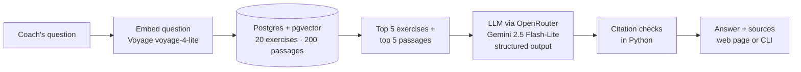
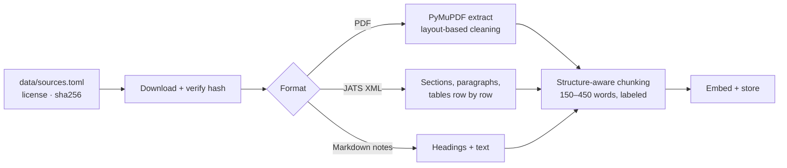

# rag-motion

A retrieval-augmented assistant for strength coaches. Ask a training question in plain English and get an answer built **only** from vetted sources: public exercise guidelines, open-access research, coaching notes, and an exercise catalog. Every claim links to its source, and code checks every citation.

Built step by step as an AI-engineering portfolio project, with every decision and lesson documented in [`docs/`](docs/).

**Status:** Phase 1 (production RAG fundamentals) complete. Next: metadata filters and retrieval improvements (Phase 1F), then a program-design agent (Phase 2).

---

## What it does

- **Answers from evidence, not memory.** The model sees only retrieved passages and exercises, cites each one by id, and says plainly when the sources don't cover a question.
- **Shows its work.** The web page color-codes citations (guidelines, research, notes, catalog) and opens the exact source passage on click. General training knowledge, when useful, is shown separately and labeled "not from your sources".
- **Checks itself.** Python verifies that every citation points to retrieved evidence, catching invented or mistyped sources before the user trusts them.
- **Is measured.** A 31-question evaluation set, with an answer key reviewed by a coach, scores both retrieval and answers. Every change is judged against it.

## How it works



**Ingestion** (one-time per source):



Key design choices (full reasoning in [`docs/decisions/`](docs/decisions/README.md)):

| Choice | Why |
|---|---|
| Postgres + pgvector, not a separate vector database | Exercises, passages, and vectors live together; filters and similarity run in one query |
| Structure-aware chunks with a location label (`title > chapter > section`) | One topic per chunk; the label gives context instead of overlap and makes citations readable |
| Research papers as structured XML, not PDF | No two-column layout guessing; tables survive row by row |
| Structured output + code-based citation checks | A valid shape doesn't guarantee valid content; code catches what the model gets wrong |
| Evidence-only answers with separately labeled general guidance | The coach can always tell what's verified from what isn't |
| Code-based eval checks, not an LLM judge | Deterministic, free, and never the model grading itself |

## Knowledge base

| Source | Type | License | Passages |
|---|---|---|---|
| Physical Activity Guidelines for Americans, 2nd ed. (HHS, 2018) | Guideline document (PDF) | Public domain | 133 |
| Kons et al. 2023, *Effects of Plyometric Training on Physical Performance: An Umbrella Review* | Research article (XML) | CC BY 4.0 | 25 |
| Haugen et al. 2019, *The Training and Development of Elite Sprint Performance* | Research article (XML) | CC BY 4.0 | 28 |
| Notes on NSCA position statements: weightlifting, older adults, youth/LTAD | Original project notes | Project-owned; cite NSCA | 14 |
| Exercise catalog | 20 original exercises | Project-owned | – |

Sources are chosen under a written [licensing policy](docs/decisions/0017-knowledge-source-licensing-policy.md): copyrighted material (for example NSCA publications) is never ingested; it enters only as original notes that cite it. Downloaded files stay out of git; [`data/sources.toml`](data/sources.toml) records each source's URL, license, attribution, and file hash.

## Evaluation

31 questions in [`evals/eval_set.yaml`](evals/eval_set.yaml): exercise selection, coach jargon, equipment constraints, guideline dosage, population-specific advice, research questions, and deliberately unanswerable ones. The answer key was drafted by the model and **reviewed question by question by the coach**, who corrected several expectations.

**Retrieval** (top 5, no LLM involved):

| Search mode | Exercise recall | Passage recall | Passage MRR |
|---|---|---|---|
| **Semantic (default)** | **0.91** | **0.97** | 0.78 |
| Keyword (Postgres full-text) | 0.66 | 0.69 | 0.56 |
| Hybrid (reciprocal rank fusion) | 0.85 | 0.95 | 0.87 |

**Answers** (full pipeline, scored by code, tracked as LangSmith experiments):

| Check | Result |
|---|---|
| Every citation points to retrieved evidence | 31 / 31 |
| Used the expected evidence | 30 / 30 |
| Honest coverage claim (full / partial / none) | 29 / 31 |
| No forbidden advice (wrong equipment or population) | **2 / 5** |

What the numbers say: citations are reliable and the system admits gaps (it correctly answers "not covered" to a nutrition question it has no sources for). Its clear weakness is **respecting constraints**: it can still suggest bench exercises to someone with only dumbbells, or older-adult numbers to a beginner adult. Prompt wording didn't fix this; the planned fix is metadata filters (equipment and population) applied before retrieval, measured against this same eval.

Adding the two research papers is an example of the eval loop: sprint-acceleration questions went from "not covered" to specific, cited answers, with citation validity and evidence use unchanged.

## Run it locally

**Prerequisites:** [Docker](https://www.docker.com/), [uv](https://docs.astral.sh/uv/), an [OpenRouter](https://openrouter.ai) API key (covers the LLM and embeddings). Optional: a [LangSmith](https://smith.langchain.com) key for tracing.

```bash
git clone https://github.com/muskii1z/rag-motion.git && cd rag-motion
cp .env.example .env          # then add OPENROUTER_API_KEY (and optionally LANGSMITH_API_KEY)
uv sync                       # install dependencies

docker compose up -d --wait   # start Postgres + pgvector on localhost:5434
docker compose exec -T db psql -U postgres -d ragmotion -v ON_ERROR_STOP=1 < db/schema.sql

uv run python scripts/seed_exercises.py        # load the exercise catalog
uv run python scripts/embed_exercises.py       # embed it
uv run python scripts/download_sources.py      # fetch source documents, verify hashes
uv run python scripts/extract_document.py pag2 # extract the PDF
uv run python scripts/chunk_documents.py       # chunk all sources
uv run python scripts/embed_chunks.py          # embed the chunks
```

Then ask questions:

```bash
uv run uvicorn ragmotion.app:app --host 127.0.0.1 --port 8010   # web app at http://127.0.0.1:8010
uv run python scripts/ask.py "How much strength training should a beginner adult do each week?"
```

Tests and evaluation:

```bash
uv run pytest                                  # 31 tests, ~0.3 s, no API calls
uv run python evals/run_retrieval_eval.py      # retrieval scores (free)
uv run python evals/run_answer_eval.py         # answer scores (~2 cents, needs LangSmith key)
```

## Project layout

```
src/ragmotion/   config, db, models, llm, embeddings, retrieval, rag, ingestion, chunking, evaluation, errors, web app
scripts/         seed, embed, download, extract, chunk, search, ask
evals/           eval set (coach-reviewed) and saved results
db/              schema and inspection queries
data/            source manifest, exercise catalog, project notes (downloads in git-ignored data/raw/)
docs/            build log, decisions, concepts, interview prep, source research
tests/           unit and integration tests
```

## Documentation

- [Build log](docs/build-log.md): every step, including what broke and how it was fixed
- [Decisions](docs/decisions/README.md): each choice, the alternatives, and the tradeoffs
- [Concepts](docs/concepts.md): everything learned along the way, in plain language
- [Source research](docs/sources/candidates.md): candidate knowledge sources and their licenses

## Limitations

- Answers don't yet respect equipment or population limits reliably (see Evaluation).
- Top-5 retrieval is too small for "list everything" questions.
- The catalog has 20 exercises; program-design sources (sets, reps, frequency) are still thin.
- Each question is answered on its own; there is no conversation memory.
- Not medical advice. Built for coaches working with generally healthy people; demo data is fictional.
