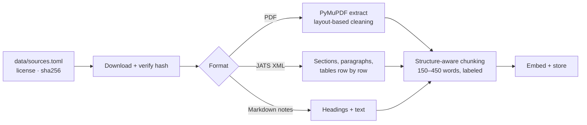

# rag-motion

A retrieval-augmented assistant for strength coaches. Ask a training question in plain English and get an answer built **only** from vetted sources: public exercise guidelines, open-access research, coaching notes, and an exercise catalog. Every claim links to its source, and code checks every citation.

Built step by step as an AI-engineering portfolio project, with every decision and lesson documented in [`docs/`](docs/).

**Status:** Phase 1 (production RAG fundamentals) complete. Phase 1F: equipment and age-group filters done; answers that broke a limit went from 4 in 13 to 0 in 13 on the eval. Next: retrieval improvements for "list everything" questions, then a program-design agent (Phase 2).

---

## What it does

- **Answers from evidence, not memory.** The model sees only retrieved passages and exercises, cites each one by id, and says plainly when the sources don't cover a question.
- **Shows its work.** The web page color-codes citations (guidelines, research, notes, catalog) and opens the exact source passage on click. General training knowledge, when useful, is shown separately and labeled "not from your sources".
- **Respects limits.** It reads the person's equipment and age group from the question and filters the search, so someone with only dumbbells never gets a bench exercise, and a beginner adult never gets older-adult numbers.
- **Checks itself.** Python verifies that every citation points to retrieved evidence, catching invented or mistyped sources before the user trusts them.
- **Is measured.** A 46-question evaluation set, with an answer key reviewed by a coach, scores both retrieval and answers. Every change is judged against it.

## How it works


**Ingestion** (one-time per source):



Key design choices (full reasoning in [`docs/decisions/`](docs/decisions/README.md)):

| Choice | Why |
|---|---|
| Postgres + pgvector, not a separate vector database | Exercises, passages, and vectors live together; filters and similarity run in one query |
| Structure-aware chunks with a location label (`title > chapter > section`) | One topic per chunk; the label gives context instead of overlap and makes citations readable |
| Research papers as structured XML, not PDF | No two-column layout guessing; tables survive row by row |
| Structured output + code-based citation checks | A valid shape doesn't guarantee valid content; code catches what the model gets wrong |
| Evidence-only answers with separately labeled general guidance | The coach can always tell what's verified from what isn't |
| Limits enforced by filters in the database search, not prompt rules | With prompt rules alone, 5 of 13 constrained answers still broke a limit; the model can't suggest what it never sees |
| Age-group tags on passages from the source's own structure | The guidelines are organized by population, so rules tag every passage for free, testably, with no model guessing |
| Code checks for facts; an AI judge only for the coach's labeling rules | Facts (real citation? forbidden item?) stay deterministic. Rules that need reading ("is it labeled intermediate?") go to a stronger model from a different family, never the one that wrote the answer |

## Knowledge base

| Source | Type | License | Passages |
|---|---|---|---|
| Physical Activity Guidelines for Americans, 2nd ed. (HHS, 2018) | Guideline document (PDF) | Public domain | 133 |
| Kons et al. 2023, *Effects of Plyometric Training on Physical Performance: An Umbrella Review* | Research article (XML) | CC BY 4.0 | 25 |
| Haugen et al. 2019, *The Training and Development of Elite Sprint Performance* | Research article (XML) | CC BY 4.0 | 28 |
| Notes on NSCA position statements: weightlifting, older adults, youth/LTAD | Original project notes | Project-owned; cite NSCA | 14 |
| Exercise catalog | 42 original exercises (22 coach-reviewed) | Project-owned | – |

Sources are chosen under a written [licensing policy](docs/decisions/0017-knowledge-source-licensing-policy.md): copyrighted material (for example NSCA publications) is never ingested; it enters only as original notes that cite it. Downloaded files stay out of git; [`data/sources.toml`](data/sources.toml) records each source's URL, license, attribution, and file hash.

## Evaluation

46 questions in [`evals/eval_set.yaml`](evals/eval_set.yaml): exercise selection, coach slang (RDL, RFESS, BW, DB), equipment limits (bands only, one kettlebell, no equipment, a full gym), guideline dosage, specific groups (beginner adults, older adults, kids, pregnancy), research questions, and deliberately unanswerable ones. The answer key was drafted by the model and **set question by question by the coach**. One question is a trap: with a full gym nothing should be removed, so it catches a filter that's too strict.

**Retrieval** (top 5, all 46 questions; each row adds one change):

| Search setup | Exercise recall | Passage recall | Passage MRR | Questions with a forbidden item |
|---|---|---|---|---|
| Keyword (Postgres full-text) | 0.64 | 0.66 | 0.50 | 15% |
| Hybrid, keyword + semantic merged (reciprocal rank fusion) | 0.77 | 0.93 | 0.84 | 22% |
| Semantic | 0.81 | 0.97 | 0.79 | 17% |
| Semantic + equipment and age-group filters | 0.83 | 0.97 | 0.86 | 2% |
| **+ slang dictionary (default)** | **0.87** | **0.97** | **0.86** | **0%** |
| *Tried:* hybrid + filters + slang, semantic weighted 2:1 | 0.83 | 0.96 | 0.84 | 0% |
| *Tried:* semantic for exercises, hybrid for passages | 0.87 | 0.96 | 0.84 | 0% |

Hybrid search used to rank passages better than semantic (0.84 vs 0.79). Once the age-group filter removed wrong-group passages, semantic ranked them best (0.86), so hybrid no longer earns its place. The split variant (the stronger of the two) was also checked on full answers (3 runs): no gain, and a worse coverage claim (0.855 vs 0.906), so semantic stays the default. Full hybrid wasn't run on answers, since it already trailed on exercise retrieval.

**Slang** ("RFESS", "BW squat", "DB row"): probing 20 slang questions showed the embedding model already understood 16. A small glossary, expanded before search (longest term first, whole words only), fixed the rest: the slang questions' expected exercise was found 89% → 100% of the time, with no added time. An LLM rewrite scored the same but added 0.6 s per question, so the dictionary won.

**Answers**, before and after the filters (full pipeline, scored in code, averaged over 3 runs each, results saved in `evals/results/`):

| Check | No filters | With filters |
|---|---|---|
| **No forbidden advice** (wrong equipment or age group) | **69%** (27 / 39) | **100%** (39 / 39) |
| Every citation points to retrieved evidence | 98% | 98% |
| Used the expected evidence | 98% | 98% |
| Honest coverage claim (full / partial / none) | 88% | 91% |

The coach's labeling rules (label intermediate exercises for beginners, label bodyweight options and secondary muscles, group beginner exercises by muscle group) are graded by an AI judge: Claude Sonnet 5.5, a different model family from the one that writes answers. It reads the answer against the catalog's facts and gives a verdict with a one-sentence reason for the coach to check.

What the numbers say: before the filters, the system could still suggest bench exercises to someone with only dumbbells, or older-adult numbers to a beginner adult, even though the prompt told it not to. Moving the limit out of the prompt and into the search fixed that completely on this eval, without losing anything elsewhere. The trap question still passes, so nothing usable was filtered out. The remaining weakness is breadth: with only 5 exercises in view, it can't list "every beginner exercise by muscle group".

Two lessons from the process: when the catalog grew from 20 to 42 exercises, recall "fell" only because the answer key was out of date, so the key was fixed before anything else was measured. And single runs are noisy (the coverage claim changes from run to run), so the before-and-after comparison uses averages.

## Run it locally

**Prerequisites:** [Docker](https://www.docker.com/), [uv](https://docs.astral.sh/uv/), an [OpenRouter](https://openrouter.ai) API key (covers the LLM and embeddings). Optional: a [LangSmith](https://smith.langchain.com) key for tracing.

```bash
git clone https://github.com/muskii1z/rag-motion.git && cd rag-motion
cp .env.example .env          # then add OPENROUTER_API_KEY (and optionally LANGSMITH_API_KEY)
uv sync                       # install dependencies

docker compose up -d --wait   # start Postgres + pgvector on localhost:5434
docker compose exec -T db psql -U postgres -d ragmotion -v ON_ERROR_STOP=1 < db/schema.sql

uv run python scripts/seed_exercises.py        # load the exercise catalog
uv run python scripts/embed_exercises.py       # embed it
uv run python scripts/download_sources.py      # fetch source documents, verify hashes
uv run python scripts/extract_document.py pag2 # extract the PDF
uv run python scripts/chunk_documents.py       # chunk all sources
uv run python scripts/embed_chunks.py          # embed the chunks
```

Then ask questions:

```bash
uv run uvicorn ragmotion.app:app --host 127.0.0.1 --port 8010   # web app at http://127.0.0.1:8010
uv run python scripts/ask.py "How much strength training should a beginner adult do each week?"
```

Tests and evaluation:

```bash
uv run pytest                                  # 54 tests, ~1 s, no API calls
uv run python evals/run_retrieval_eval.py      # retrieval scores (free)
uv run python evals/run_answer_eval.py         # answer scores + AI judge (~10 cents), saved to evals/results/
uv run python evals/run_answer_eval.py --langsmith   # also record it as a LangSmith experiment
uv run python evals/run_answer_eval.py --no-filters   # the same, without the filters, for comparison
```

## Project layout

```
src/ragmotion/   config, db, models, llm, embeddings, retrieval, rag, ingestion, chunking, evaluation, errors, web app
scripts/         seed, embed, download, extract, chunk, search, ask
evals/           eval set (coach-reviewed) and saved results
db/              schema and inspection queries
data/            source manifest, exercise catalog, project notes (downloads in git-ignored data/raw/)
docs/            build log, decisions, concepts, interview prep, source research
tests/           unit and integration tests
```

## Documentation

- [Build log](docs/build-log.md): every step, including what broke and how it was fixed
- [Decisions](docs/decisions/README.md): each choice, the alternatives, and the tradeoffs
- [Concepts](docs/concepts.md): everything learned along the way, in plain language
- [Source research](docs/sources/candidates.md): candidate knowledge sources and their licenses

## Limitations

- Top-5 retrieval is too small for "list everything" questions.
- Limits are read from the current question only. The level (beginner, advanced) is read but not used as a filter yet.
- The catalog has 42 exercises (the original 20 still await coach review); program-design sources (sets, reps, frequency) are still thin.
- Each question is answered on its own; there is no conversation memory.
- Not medical advice. Built for coaches working with generally healthy people; demo data is fictional.
