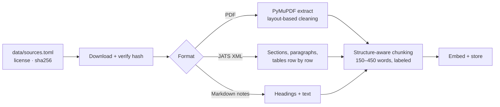

# rag-motion

A retrieval-augmented assistant for strength coaches. Ask a training question in plain English and get an answer built **only** from vetted sources: public exercise guidelines, open-access research, coaching notes, and an exercise catalog. Every claim links to its source, and code checks every citation.

Built step by step as an AI-engineering portfolio project, with every decision and lesson documented in [`docs/`](docs/).

**Status:** Phase 1 (production RAG fundamentals) and Phase 1F (better retrieval, measured) complete. Answers that broke a client's equipment or age-group limits went from 31% to 0%. Next: Phase 2, a program generator (sets, reps and a weekly schedule) built on this retrieval.

---

## What it does

- **Answers from evidence, not memory.** The model sees only retrieved passages and exercises, cites each one by id, and says plainly when the sources don't cover a question.
- **Shows its work.** The web page color-codes citations (guidelines, research, notes, catalog) and opens the exact source passage on click. General training knowledge, when useful, is shown separately and labeled "not from your sources".
- **Respects limits.** It reads the person's equipment and age group from the question and filters the search, so someone with only dumbbells never gets a bench exercise, and a beginner adult never gets older-adult numbers.
- **Checks itself.** Python verifies that every citation points to retrieved evidence, catching invented or mistyped sources before the user trusts them.
- **Understands coach slang.** "RFESS", "BW squat", "SL RDL" and "KBS" are expanded before search by a small, tested glossary.
- **Is measured.** A 52-question evaluation set, with an answer key reviewed by a coach, scores both retrieval and answers. Every change is judged against it.

## How it works


**Ingestion** (one-time per source):



Key design choices (full reasoning in [`docs/decisions/`](docs/decisions/README.md)):

| Choice | Why |
|---|---|
| Postgres + pgvector, not a separate vector database | Exercises, passages, and vectors live together; filters and similarity run in one query |
| Structure-aware chunks with a location label (`title > chapter > section`) | One topic per chunk; the label gives context instead of overlap and makes citations readable |
| Research papers as structured XML, not PDF | No two-column layout guessing; tables survive row by row |
| Structured output + code-based citation checks | A valid shape doesn't guarantee valid content; code catches what the model gets wrong |
| Evidence-only answers with separately labeled general guidance | The coach can always tell what's verified from what isn't |
| Limits enforced by filters in the database search, not prompt rules | With prompt rules alone, 5 of 13 constrained answers still broke a limit; the model can't suggest what it never sees |
| Age-group tags on passages from the source's own structure | The guidelines are organized by population, so rules tag every passage for free, testably, with no model guessing |
| Slang expanded by a glossary, not an LLM rewrite | Same quality as an LLM rewrite in testing, no added time, deterministic and unit-tested |
| Code checks for facts; an AI judge only for the coach's labeling rules | Facts (real citation? forbidden item?) stay deterministic. Rules that need reading ("is it labeled intermediate?") go to a stronger model from a different family, never the one that wrote the answer |

## Knowledge base

| Source | Type | License | Passages |
|---|---|---|---|
| Physical Activity Guidelines for Americans, 2nd ed. (HHS, 2018) | Guideline document (PDF) | Public domain | 133 |
| Kons et al. 2023, *Effects of Plyometric Training on Physical Performance: An Umbrella Review* | Research article (XML) | CC BY 4.0 | 25 |
| Haugen et al. 2019, *The Training and Development of Elite Sprint Performance* | Research article (XML) | CC BY 4.0 | 28 |
| Schoenfeld et al. 2021, *Loading Recommendations for Muscle Strength, Hypertrophy, and Local Endurance* | Research article (XML) | CC BY 4.0 | 28 |
| Singer et al. 2024, *Give it a rest: inter-set rest intervals and muscle hypertrophy* | Research article (XML) | CC BY 4.0 | 18 |
| Pelland et al. 2024, *The Resistance Training Dose-Response* (weekly volume and frequency) | Research **preprint, not peer reviewed** (PDF; the peer-reviewed version is paywalled) | CC BY 4.0 | 29 |
| Notes on NSCA position statements: weightlifting, older adults, youth/LTAD | Original project notes | Project-owned; cite NSCA | 14 |
| Program-design notes (load, reps, rest, sets, frequency, splits, progression) | Original project notes, coach-reviewed | Project-owned | 3 |
| Exercise catalog | 42 original exercises, all coach-reviewed | Project-owned | – |

Sources are chosen under a written [licensing policy](docs/decisions/0017-knowledge-source-licensing-policy.md): copyrighted material (for example NSCA publications) is never ingested; it enters only as original notes that cite it. Every passage is tagged with the group it's about (adults, older adults, youth, pregnancy, or general), so the program-design research on healthy adults never answers a question about a 70-year-old. Downloaded files stay out of git; [`data/sources.toml`](data/sources.toml) records each source's URL, license, attribution, and file hash.

## Evaluation

52 questions in [`evals/eval_set.yaml`](evals/eval_set.yaml): exercise selection, coach slang (RDL, RFESS, BW, DB, KBS), equipment limits (bands only, one kettlebell, no equipment, a full gym), guideline dosage, specific groups (beginner adults, older adults, kids, pregnancy), program design (weekly sets, rest, rep ranges, frequency), research questions, and deliberately unanswerable ones. The answer key was drafted by the model and **set question by question by the coach**. Two questions are traps: with a full gym nothing should be filtered out, and a 70-year-old's "how many sets" must not be answered from research on younger adults.

**Answers today** (full pipeline, 52 questions, 3 runs, scored in code; results in `evals/results/`):

| Check | Result |
|---|---|
| **No forbidden advice** (wrong equipment or age group) | **100%** (45 / 45) |
| Every citation points to retrieved evidence | 97% |
| Used the expected evidence | 95% |
| Honest coverage claim (full / partial / none) | 91% |
| Expected exercises named (list questions) | 85% |

4 of 156 question-runs failed with a clear error and are left out of the totals: 3 timeouts during a provider slowdown (each call has a 25-second limit) and 1 unreadable model reply after a retry.

**What changed the numbers.** Each change was measured on the same questions before it was kept.

| Change | Measured effect | Kept? |
|---|---|---|
| Equipment and age-group **filters in the SQL search** (prompt instructions had failed) | Forbidden advice 31% → 0% of limit questions (3 runs each, 40-question version); recall 0.80 → 0.83 | ✅ |
| **Slang glossary** before search | Slang questions found the expected exercise 89% → 100%; forbidden-free 93% → 100% | ✅ |
| LLM rewrite of slang instead of the glossary | Same quality, +0.6 s per question | ❌ |
| **Hybrid search** (keyword + semantic, weighted 1:1 to 3:1), or hybrid only for passages | With filters on, semantic ranked passages best (MRR 0.84 vs 0.81–0.83); split answers had a worse coverage claim | ❌ |
| 10 exercises per question instead of 5 | Lists 12% more complete, but more unasked-for exercises in focused answers | ❌ |
| The coach's formatting rules added to the answer prompt | No version beat the plain prompt; padded focused answers | ❌ |

**Retrieval** today (top 5, 52 questions):

| Search setup | Exercise recall | Passage recall | Passage MRR | Questions with a forbidden item |
|---|---|---|---|---|
| Keyword (Postgres full-text) | 0.64 | 0.55 | 0.45 | 13% |
| Hybrid (reciprocal rank fusion) | 0.75 | 0.90 | 0.83 | 17% |
| Semantic | 0.81 | 0.95 | 0.81 | 15% |
| **Semantic + filters + slang glossary (default)** | **0.87** | **0.95** | **0.84** | **0%** |

The coach's labeling rules (label intermediate exercises for beginners, label bodyweight options and secondary muscles, group beginner exercises by muscle group) are graded by an AI judge: Claude Sonnet 5.5, a different model family from the one that writes answers, checked against the catalog's facts. The rule that still fails is grouping a full beginner list by muscle group, which needs more than 5 exercises in view.

Lessons from the process: when the catalog grew from 20 to 42 exercises, recall "fell" only because the answer key was out of date, so keys are fixed before anything is measured. Single runs are noisy, so comparisons use 3-run averages. And an earlier change can remove the problem a later technique was meant to solve: the age-group filter is why hybrid search no longer helps.

## Run it locally

**Prerequisites:** [Docker](https://www.docker.com/), [uv](https://docs.astral.sh/uv/), an [OpenRouter](https://openrouter.ai) API key (covers the LLM and embeddings). Optional: a [LangSmith](https://smith.langchain.com) key for tracing (off by default; set `LANGSMITH_TRACING=true` to debug a request).

```bash
git clone https://github.com/muskii1z/rag-motion.git && cd rag-motion
cp .env.example .env          # then add OPENROUTER_API_KEY (and optionally LANGSMITH_API_KEY)
uv sync                       # install dependencies

docker compose up -d --wait   # start Postgres + pgvector on localhost:5434
docker compose exec -T db psql -U postgres -d ragmotion -v ON_ERROR_STOP=1 < db/schema.sql

uv run python scripts/seed_exercises.py        # load the exercise catalog
uv run python scripts/embed_exercises.py       # embed it
uv run python scripts/download_sources.py      # fetch source documents, verify hashes
uv run python scripts/extract_document.py pag2                # extract the PDFs
uv run python scripts/extract_document.py pelland2024-volume
uv run python scripts/chunk_documents.py       # chunk all sources
uv run python scripts/embed_chunks.py          # embed the chunks
```

Then ask questions:

```bash
uv run uvicorn ragmotion.app:app --host 127.0.0.1 --port 8010   # web app at http://127.0.0.1:8010
uv run python scripts/ask.py "How much strength training should a beginner adult do each week?"
```

Tests and evaluation:

```bash
uv run pytest                                  # 55 tests, ~1 s, no API calls
uv run python evals/run_retrieval_eval.py      # retrieval scores (free)
uv run python evals/run_answer_eval.py         # answer scores + AI judge (~10 cents), saved to evals/results/ (LangSmith not needed)
uv run python evals/run_answer_eval.py --langsmith   # also record it as a LangSmith experiment
uv run python evals/run_answer_eval.py --no-filters   # the same, without the filters, for comparison
```

## Project layout

```
src/ragmotion/   config, db, models, llm, embeddings, retrieval, rewrite, rag, ingestion, chunking, evaluation, judge, errors, web app
scripts/         seed, embed, download, extract, chunk, search, ask
evals/           eval set (coach-reviewed) and saved results
db/              schema and inspection queries
data/            source manifest, exercise catalog, project notes (downloads in git-ignored data/raw/)
docs/            build log, decisions, concepts, interview prep, source research
tests/           unit and integration tests
```

## Documentation

- [Build log](docs/build-log.md): every step, including what broke and how it was fixed
- [Decisions](docs/decisions/README.md): each choice, the alternatives, and the tradeoffs
- [Concepts](docs/concepts.md): everything learned along the way, in plain language
- [Source research](docs/sources/candidates.md): candidate knowledge sources and their licenses

## Limitations

- Top-5 retrieval is too small for "list everything" questions.
- Limits are read from the current question only. Training level (beginner, advanced) isn't a filter yet; the answer model handles it from each exercise's level label.
- The catalog has 42 exercises; some areas (e.g. beginner hamstring work) are thin.
- One program-design source is a preprint (labeled as such); the program generator itself is Phase 2.
- The answer model occasionally returns an unreadable reply even after a retry (about 1 in 150 in the final runs); the app shows a clear "please ask again" message.
- Each question is answered on its own; there is no conversation memory.
- Not medical advice. Built for coaches working with generally healthy people; demo data is fictional.
